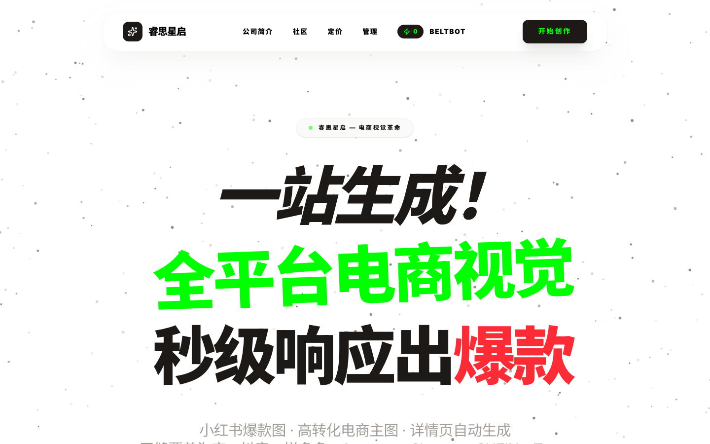
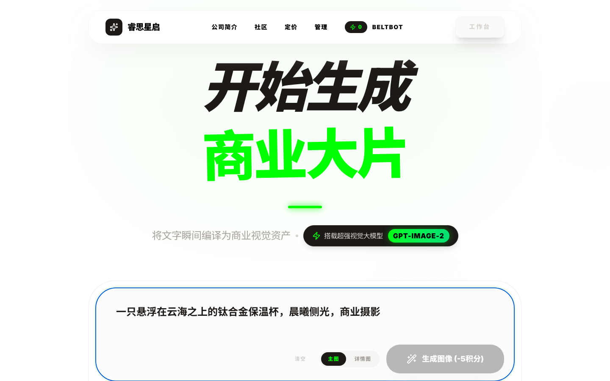
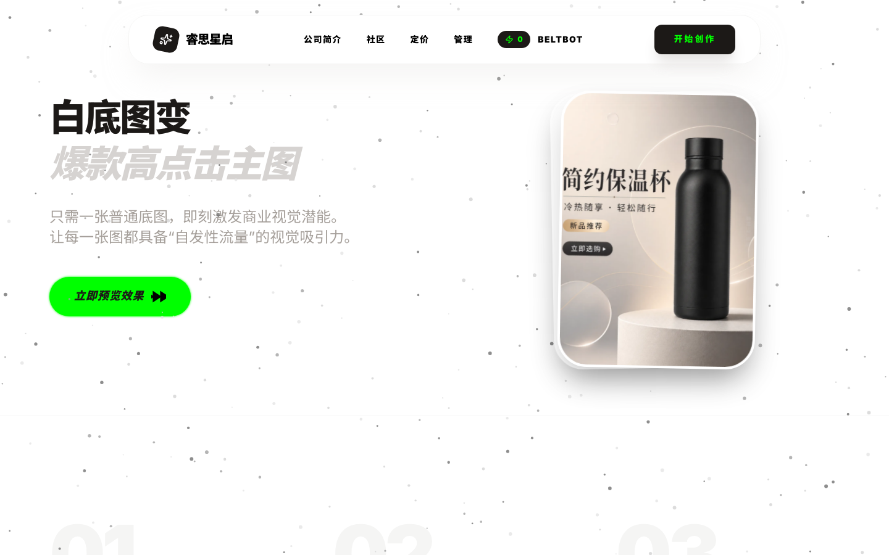
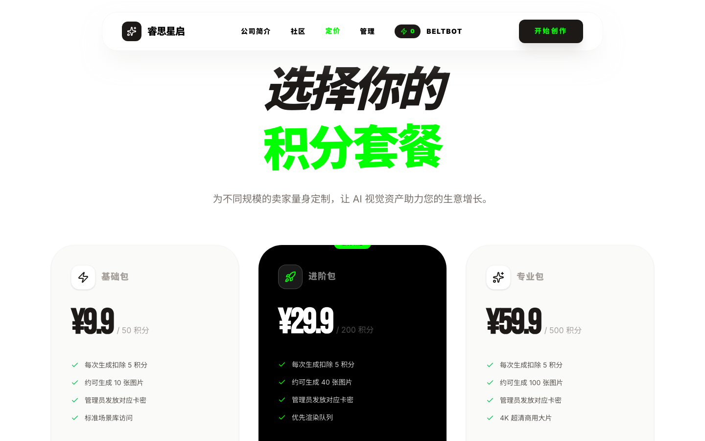
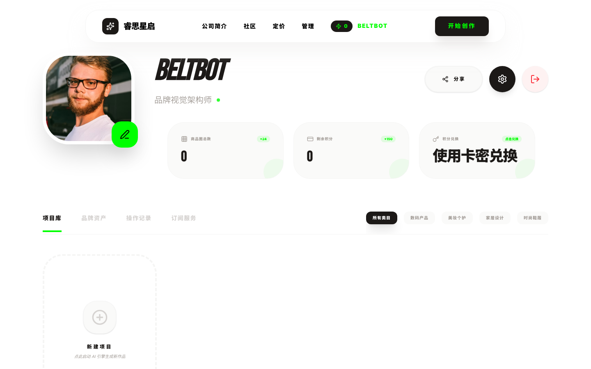

# SparkCommerce AI — AI 电商影像平台

> 一站式 AI 电商影像工作台:卖家输入一句产品描述,秒级生成商业摄影级的商品主图与详情页。
> **独立全栈项目** · 2025 · 已独立部署上线(阿里云)

| | |
| --- | --- |
| **角色** | 独立开发(产品定义 / UI 设计 / 前端 / 后端 / 数据库 / 部署运维) |
| **前端** | React 19 · Vite 6 · Tailwind CSS 4 · Motion |
| **后端** | Express 5 · TypeScript · Prisma · JWT · Zod |
| **AI** | OpenAI 兼容图像生成 API · MiniMax |
| **基础设施** | MySQL(生产)/ SQLite(开发) · Nginx · PM2 · 阿里云 ECS |

---

## 解决什么问题

中小电商卖家做一套商品视觉(主图 + 详情页)的传统路径是:找摄影、搭场景、修图排版——成本高、周期长,多平台铺货时还要重复适配。SparkCommerce AI 把这条链路压缩成"一句描述 → 约 30 秒出图",让一个人就能管理多个 SKU 的视觉资产。

## 产品功能

**创作工作台**
输入产品描述即可出图,支持主图 / 详情图两种模式、画幅比例与画质选择、海报风格参数;内置 10+ 品类提示词模版(天猫大牌、小红书种草、美妆微距、3C 数码、美食、家居、运动户外、珠宝奢品等),白底图可一键转为场景化营销图。

**商业化闭环**
积分制计费(每次生成扣 5 积分),三档套餐 ¥9.9 / ¥29.9 / ¥59.9;管理员线下收款后发放卡密,用户在个人中心兑换积分。订单、卡密、兑换日志全链路落库。

**社区与资产管理**
用户作品可发布到社区,支持点赞、收藏与排行榜;个人中心提供项目库、品牌资产、操作记录、订阅服务四个维度的管理。

**管理后台**
卡密生成与发放、用户列表、图片审核、订单管理、购买日志五个模块,完整的运营支撑。

## 界面一览

| 落地页 · 首屏 | 落地页 · 效果演示 |
| --- | --- |
|  |  |

| 创作工作台 | 高转化图库 |
| --- | --- |
|  |  |

| 社区 · 提示词模版 | 白底图变主图 |
| --- | --- |
|  |  |

| 积分定价 | 个人中心 |
| --- | --- |
|  |  |

## 技术架构

```
┌─────────────┐     ┌──────────────────┐     ┌─────────────────┐
│  React SPA   │────▶│  Express API      │────▶│  AI 图像生成 API  │
│  (Vite)      │     │  模块化路由        │     │  (OpenAI 兼容)    │
└─────────────┘     │  JWT 鉴权 + Zod 校验│     └─────────────────┘
                    │        │           │
                    │  Prisma ORM        │     ┌─────────────────┐
                    │        ▼           │────▶│  阿里云 OSS/Nginx  │
                    │  MySQL / SQLite    │     │  静态与生成图托管    │
                    └──────────────────┘     └─────────────────┘
```

**数据模型**:`User` / `Image` / `Like` / `Order` / `RedeemKey` / `OrderLog` 六张表,支撑"积分 + 卡密 + 订单 + 社区"的完整商业闭环。

**后端组织**:按业务域模块化(`auth` / `users` / `images` / `community` / `pricing` / `orders` / `admin`),统一鉴权中间件与参数校验,接口契约清晰。

## 工程亮点

- **提示词引擎(Prompt Engine)**:用户输入经过风格匹配 + 关键词触发的组装层再交给图像模型,把品类摄影经验沉淀为可复用的模版库,是普通用户出片质量的关键杠杆
- **轻量商业闭环**:不接入第三方支付,用"卡密兑换"跑通从定价、收款到发放的最小商业化路径,适合早期验证
- **前后端全链路类型安全**:TypeScript + Zod 校验 + Prisma 类型生成,接口改动可全局追溯
- **独立交付**:从域名、服务器配置到 Nginx 反代、PM2 进程守护,一个人完成生产环境上线

## 挑战与收获

- **AI 成本与体验的平衡**:生成调用按次计费,采用"先出图、后扣积分"的设计——图像成功落库才扣减额度,失败不计费,既防止资损也给用户明确的消费预期;生成图可选上传阿里云 OSS,未配置时自动回退本地存储
- **从 demo 到产品**:补齐了注册登录、权限分级(用户/管理员)、内容审核这些"不性感但必需"的部分,项目因此成为一个可运营的产品而非玩具

## 附录

- 原始采集工作底稿(运行记录、逐页截图清单、API 数据样本):[COLLECTION.md](COLLECTION.md)
- 接口数据样本:`api-data/` 目录(定价、风格库、社区、用户用量等真实响应)
- 采集脚本:[collect.mjs](collect.mjs)(Playwright 无头浏览器自动截图 + API 直采,可复现)
