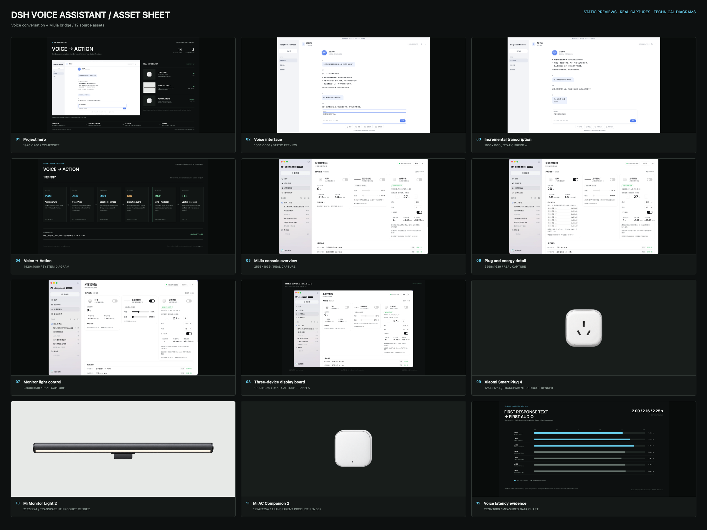

# DSH Voice Assistant 图片素材包

共 12 张主素材，另附 1 张总览联系表。未修改 Personal-Website 或任何页面代码。

本包未使用 AI 生成图片。主图、展示板、架构图和数据图均由项目真实截图、现有产品渲染图及公开仓库中的资料排版制作。

## 快速预览

## 素材清单

| 编号 | 文件 | 尺寸 | 类型 | 建议用途 |
| --- | --- | --- | --- | --- |
| 01 | `01-dsh-voice-assistant-hero.png` | 1920×1200 | 合成主图 | 项目封面、作品页主视觉 |
| 02 | `02-voice-interface-preview.png` | 1600×1000 | 静态界面预览 | 语音助手完整界面 |
| 03 | `03-voice-interaction-detail.png` | 1600×1000 | 静态界面预览 | 边说边转写、键盘与语音控制状态 |
| 04 | `04-voice-to-action-flow.png` | 1920×1080 | 系统架构图 | 解释语音到设备执行与语音反馈的链路 |
| 05 | `05-mijia-console-overview.webp` | 2558×1639 | 真实运行截图 | 米家控制台与三台设备总览 |
| 06 | `06-mijia-plug-energy-detail.webp` | 2558×1639 | 真实运行截图 | 灯带 26 W、最近 7 天用电明细 |
| 07 | `07-mijia-lightbar-control.webp` | 2558×1639 | 真实运行截图 | 挂灯开关、亮度和色温控制 |
| 08 | `08-mijia-device-status.png` | 1920×1280 | 真实截图展示板 | 带三设备说明的案例详情图 |
| 09 | `09-device-smart-plug.png` | 1254×1254 | 透明产品图 | 小米智能插座 4 |
| 10 | `10-device-monitor-light.png` | 2172×724 | 透明产品图 | 米家显示器挂灯 2 |
| 11 | `11-device-ac-companion.png` | 1254×1254 | 透明产品图 | 米家空调伴侣 2 |
| 12 | `12-voice-latency-evidence.png` | 1920×1080 | 实测数据图 | 首段正文到首声的 7 个复测样本 |

`00-contact-sheet.png` 为 2400×1800 总览图，不计入 12 张主素材。

## 来源与标注

### 语音界面

- 来源：`dsh-voice-conversation/docs/voice-preview.html`。
- 02 是仓库静态预览的完整渲染。
- 03 使用同一真实组件预览，滚动到“正在转写”的底部状态。
- 两者都不是 Harness 实机截图，原始预览标注已保留。

### 米家真实截图

- 05、06、07 直接来自 `dsh-mijia-console/docs/images/`。
- 08 使用 05 的完整运行截图，外部增加标题与三设备说明，没有修改截图中的设备数据。
- 01 中的设备状态取自这些真实界面，但作为封面示例展示，不表示当前在线状态。

### 产品渲染图

- 09、10、11 来自 `dsh-mijia-console/bundles/mijia-console/assets/`，透明通道已保留。
- 原仓库注明产品图为小米官方产品渲染图，版权归小米，仅作设备识别用途。

### 技术图

- 04 根据两个公开仓库的实际链路制作；示例工具名为 `mcp__mijia__set_device_property`。
- ASR 标注为增量快照，不写成原生流式识别。
- 12 使用 `docs/diagnostics/voice-latency/run-20261024-02/review.md` 中的 7 个样本。
- 12 的指标仅为“首段正文 → 首声”，不是端到端语音响应时间，不包含此前的识别和模型生成等待。

## 源码

- https://github.com/xuanyu6868/dsh-voice-conversation
- https://github.com/xuanyu6868/dsh-mijia-console
